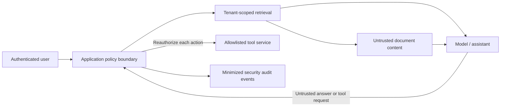

# AI Assistant Security

## Scope and Assumptions

An application retrieves tenant-owned documents and can invoke a small set of
business tools. The model may process hostile user input and untrusted
retrieved content. The model is not an authorization authority; the application
and tool service enforce access on each request.

The companion [AI application security lab](https://github.com/1B05H1N/ai-application-security-lab)
uses deterministic fixtures rather than a real model. It demonstrates control
failures and expected outcomes, not model robustness or production readiness.

## Assets and Boundaries

Assets include tenant records, sensitive fields, tool side effects, identity
claims, and audit data. A user can submit adversarial text and may influence
retrieved content. A compromised or manipulated model can propose unsafe
actions, but cannot independently grant itself application permissions.

## Decisions

| Decision | Reason | Cost or limitation |
| --- | --- | --- |
| Enforce tenant and object authorization before retrieval results reach the model | Hidden prompt instructions cannot correct an access-control failure | Identity and policy changes must invalidate caches and derived results |
| Treat user text and retrieved content as data, not policy | Prompt instructions are not a security boundary | Prompt-injection resistance is not guaranteed by prompt wording |
| Reauthorize every tool request in the application using the user's identity | Model intent is not proof of permission | Tools need a narrow, explicit authorization contract |
| Allowlist tool names and validate arguments before side effects | Prevents arbitrary model-selected operations | New tool behavior needs reviewed policy and regression tests |
| Minimize logs and exclude prompts, retrieved content, and tool payloads by default | Limits unnecessary sensitive-data retention | Incident investigations may need separately controlled evidence capture |
| Keep tests deterministic and provider-independent | Enables repeatable checks without credentials or model variability | Does not measure real-model attack success rates |

## Verification

The companion lab includes regression tests for:

1. Cross-tenant document requests return no document or sensitive value.
2. Instructions in retrieved text do not authorize disclosure.
3. Cross-tenant, unauthorized-role, and unknown tool requests have no side effects.
4. An authorized owner and tenant administrator can perform an allowed action.
5. Audit events exclude document contents, injected instructions, and canary data.

These are local fixture checks, not tests of a deployed model or identity
provider. In a real deployment, test revoked access, cache isolation, tool
argument tampering, replay, concurrency, and observable external side effects
with synthetic data and controlled destinations.

## Residual Risk

Prompt injection remains a risk wherever models process untrusted content.
Deterministic fixtures cannot measure probabilistic model behavior, and passing
the lab does not establish that an application is safe. Assess model and
provider settings, data retention, output sinks, rate limits, abuse monitoring,
and incident response in the actual deployment context.
