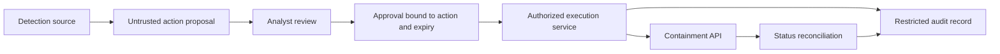

# Approval-bound incident automation

## Scope and assumptions

A detection can propose containment of a device. An analyst reviews the device,
reason, scope, and expiry before an execution service invokes a platform API.
This is a design walkthrough, not a working containment integration.

The threat includes false detections, malicious ticket text, replayed approvals,
duplicate deliveries, stale asset identifiers, and an execution timeout after
the platform has already acted.

## Boundaries

Text from a detection, ticket, or model is evidence to inspect, not an execution
instruction. The execution service needs platform permissions; the detection
source and ticketing system do not.

## Decisions

| Decision | Reason | Tradeoff |
| --- | --- | --- |
| Approval binds tenant, device, action, reason hash, approver, and expiry | An approval for one action cannot authorize an edited proposal | Material changes require another approval |
| Revalidate the asset and approver at execution time | Ownership and access may change after review | Expired or revoked requests fail rather than silently retry |
| Use an idempotency key scoped to the approved operation | Duplicate queue delivery must not duplicate execution | Platform APIs may require a reconciliation layer |
| Treat a timeout as unknown, not failure | Retrying blindly may repeat a completed action | Query platform state before deciding whether to retry |
| Keep release/reversal separate from containment | Undo has different authority and business consequences | Reversal requires its own reviewed request |
| Log identifiers and decisions, not full ticket content or credentials | Support reconstruction without unnecessary sensitive data | Detailed evidence needs separate retention and access controls |

## State walkthrough

| Event | Required transition |
| --- | --- |
| Proposal created | `proposed` |
| Authorized analyst approves the exact action | `approved` |
| Approval expires or proposal changes | `approval_invalid`; do not execute |
| Executor claims an eligible operation | `executing`, with an operation key |
| Platform confirms completion | `completed`, with platform operation ID |
| Platform call times out | `unknown`; reconcile before retry |
| Duplicate delivery arrives | Return the recorded operation state |
| Analyst requests release | Create a distinct proposal |

## Verification before deployment

1. Change a device identifier after approval; execution must be rejected.
2. Revoke the approver before execution; the approval must stop authorizing.
3. Deliver the same operation concurrently; at most one platform action occurs.
4. Force a timeout after platform success; reconciliation must not repeat it.
5. Put instructions in ticket text; they must not change the approved operation.
6. Verify cross-tenant device identifiers cannot reach the platform API.

None of these deployment tests has been performed by this documentation.

