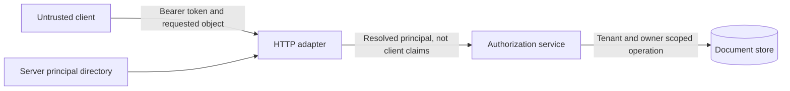

# Multi-tenant document API

## Scope and assumptions

The service stores private documents for multiple tenants. A user belongs to
one tenant and has a server-assigned role. Tenant administrators may manage
documents in their own tenant; members manage their own documents; viewers may
only read their own documents.

The supporting lab uses synthetic bearer tokens over loopback HTTP. It does
not implement production authentication, persistent storage, or an identity
provider. A deployment needs TLS, validated sessions, token revocation, and a
database transaction boundary.

## Assets and boundaries

Assets are document contents, tenant membership, roles, and deletion rights.
An attacker can control request paths, headers, JSON, and document identifiers.
They cannot change the server's principal directory.

The client-to-service boundary is untrusted even when the client is an internal
application. The HTTP adapter does not decide object access.

## Decisions

| Decision | Reason | Cost or limitation |
| --- | --- | --- |
| Resolve roles and tenants from the server's identity directory | Client-supplied claims cannot grant access | Directory changes must propagate and sessions must be revocable |
| Check tenant before owner or role | An administrator is not a cross-tenant administrator | Support operations need a separate, audited access path |
| Apply the same access rule to reads, lists, and deletion | Filtering only the detail endpoint leaves listing and mutation gaps | Authorization belongs in the service API, not individual routes |
| Return the same not-found response for absent and inaccessible objects | Avoid exposing object existence | Operators need separate, access-controlled diagnostics |
| Bind create operations to the authenticated tenant and owner | Reject mass assignment of ownership fields | Delegated creation needs an explicit permission and endpoint |
| Lock lookup and deletion together in the lab | Avoid a check/use race in shared memory | A production database must enforce the equivalent transaction invariant |

## Abuse cases and checks

| Abuse case | Expected result |
| --- | --- |
| Tenant A requests or deletes a Tenant B document | Not found; document remains unchanged |
| A member requests another member's document in the same tenant | Not found |
| A tenant administrator accesses a same-tenant document | Allowed |
| A viewer deletes their own document | Denied without mutation |
| A create request supplies `tenant`, `owner`, or `role` | Rejected |
| A list request is made by an ordinary member | Only that member's documents appear |
| A request has no valid identity | Unauthorized, before object lookup |

Run the [authorization lab's tests](https://github.com/1B05H1N/api-authorization-test-lab/blob/main/test_api.py)
with `python3 -m unittest -v` in that repository.

## Remaining deployment work

- Preserve the checks in database-backed list and mutation queries.
- Re-evaluate authorization after membership or role revocation.
- Exercise pagination, bulk exports, background jobs, and alternate API versions.
- Monitor denied operations without storing tokens or document bodies.

