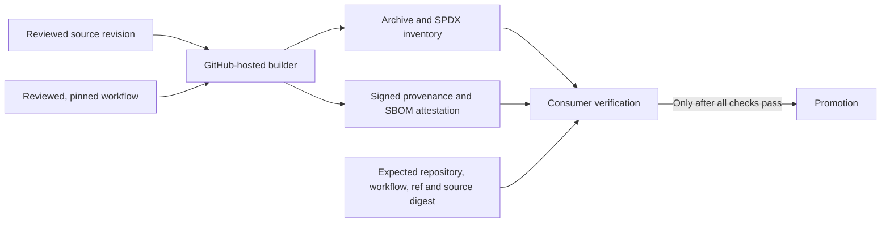

# Software release integrity

## Scope and assumptions

A small Python application is packaged by a GitHub-hosted runner. Consumers
retrieve the archive, its SPDX inventory, and a signed build attestation.
Maintainers control repository access and release approval.

The demonstration has no third-party Python packages. Its SPDX inventory covers
the files distributed in the archive, not an operating system, interpreter, or
transitive dependency graph.

## Assets and boundaries

Assets are the source revision, workflow, archive, inventory, and promotion
decision. An attacker may replace downloaded files or submit an untrusted pull
request. Compromise of a maintainer or the authorized builder is a separate,
stronger attacker capability.

## Decisions

| Decision | Reason | Cost or limitation |
| --- | --- | --- |
| Pin actions by full commit revision | A mutable action tag is not an immutable dependency | Pins need reviewed updates |
| Keep pull-request CI read-only | Untrusted changes do not need signing or publishing rights | Release operations use a separate workflow |
| Fix archive metadata and file order | Equivalent inputs can produce equivalent bytes | Reproducibility is not proof that the inputs were safe |
| Include file hashes in the SPDX inventory | Inventory can be compared with actual archive contents | Dependency discovery needs a real generator for larger applications |
| Verify signed builder identity, source ref, and source digest | A valid signature from an unexpected workflow is insufficient | The consumer must obtain expected values through a trusted release process |
| Inspect archives without extraction | Reject traversal, links, duplicate entries, and unexpected files | This policy intentionally supports only the demo's small archive |

## Failure paths

- A checksum distributed beside a replaced archive is also replaceable.
  Local hash checks do not establish publisher identity.
- A signature does not establish that the authorized builder was uncompromised.
  Workflow review, branch protection, runner isolation, and release approval
  remain necessary.
- A build attestation does not establish that software has no vulnerabilities.
- Missing, mismatched, or unverifiable attestations must block promotion.
  Do not substitute a successful checksum check.

## Verification

The [supply-chain demo](https://github.com/1B05H1N/secure-supply-chain-demo)
provides local reproducibility and tamper tests and a release workflow that
verifies provenance before making its output available.

The signed workflow must also be exercised on GitHub. Artifact attestations for
private repositories require an eligible GitHub plan. Do not report a local
inventory check as successful signature verification.

